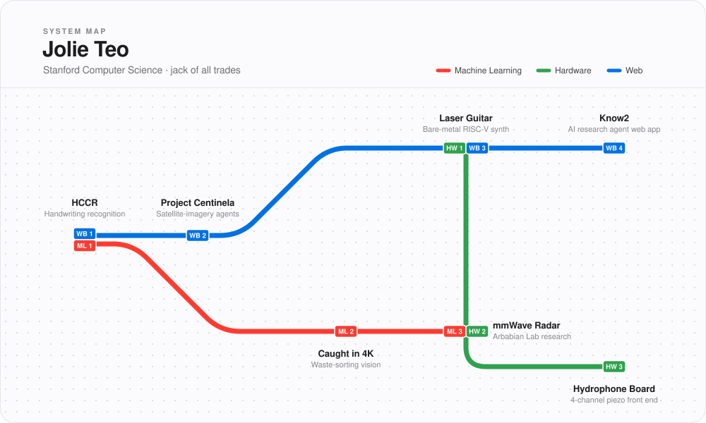

### Station guide

| Station | Lines | | |
|---|---|---|---|
| **HCCR** | ML · Web | Handwritten Chinese character recognition. Custom DenseNet121 / ResNet101 with CBAM and SE attention, 96.2% test accuracy, plus a GUI for live handwriting inference. | [demo](https://hccr-gui.vercel.app/) |
| **Project Centinela** | Web | Turns satellite-imagery requests into runnable Jupyter notebooks for conservation orgs. I built the planner and coder agents (two-stage RAG over Planet Labs notebooks) and the chat sidebar's edit mode. | [demo](https://planet-agent.vercel.app/) |
| **Caught in 4K** | ML | Waste-sorting camera that tells you which bin. Third place in a main track at HackHarvard 2026. | [repo](https://github.com/Ishan-Wakade/Caught_in_4K) |
| **mmWave Radar** | ML · Hardware | Undergraduate research at Stanford's Arbabian Lab. | |
| **Laser Guitar** | Hardware · Web | Six laser beams instead of strings, bare metal on RISC-V for CS107E. I wrote the polyphonic plucked-string synth, then ported it to the browser. | [demo](https://laser-guitar.vercel.app/) |
| **Hydrophone Board** | Hardware | 4-channel piezo hydrophone front end for Stanford RoboSub. | |
| **Know2** | Web | Software engineering intern, summer 2026. AI research agent and web app. | |

`jteo0814@gmail.com` · [LinkedIn](https://www.linkedin.com/in/jolie-teo/)